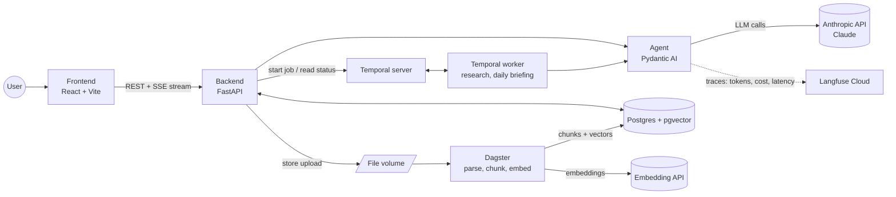

# Architecture

MGPA is a single-user assistant. One Postgres database is the system of record; three
Python processes (API, Temporal worker, Dagster) share it, each with a clear job.

## Components

| Component | Responsibility | Why this and not the alternative |
|---|---|---|
| **Frontend** (React, Chakra UI v3, TanStack Router/Query) | Chat UI, knowledge base, tasks, job status, HITL confirmations | TanStack Query caches server state so the UI does not hand-roll fetching/loading logic |
| **Backend** (FastAPI) | HTTP API, SSE streaming of agent output, persistence | Async and Pydantic-native; Django would bring an ORM/admin we do not need |
| **Agent** (Pydantic AI) | Calls Claude, exposes tools (`search_knowledge`, notes, tasks) | Typed tools and outputs; thinner than LangChain. Model ID comes from env |
| **Postgres + pgvector** | Conversations, messages, notes, tasks, documents, chunks + embeddings | One database for relational data and vectors; no separate vector DB to run |
| **Temporal** | Durable long-running jobs: multi-step research with retries/timeouts, daily briefing as a Schedule | Survives crashes and restarts mid-job and shows state; cron only fires and forgets |
| **Dagster** | Document ingestion as assets, triggered by a sensor on new uploads | Data lineage and re-materialisation per document; a plain script has neither |
| **Langfuse Cloud** | Trace every agent run, cost dashboards, eval datasets | Purpose-built for LLM apps; free hobby tier, no self-hosting |

## Key flows

1. **Chat** — Frontend posts a message → API stores it → agent streams Claude's answer back as
   Server-Sent Events → API stores the final answer; the run is traced in Langfuse.
2. **Ingestion** — API saves an uploaded PDF/Markdown file and a `documents` row (`pending`) →
   Dagster sensor picks it up → parse → chunk → embed → write `chunks` with vectors to pgvector.
3. **RAG** — Agent tool `search_knowledge` embeds the question, runs a nearest-neighbour query
   in pgvector and returns chunks with their source document for citations.
4. **Human-in-the-loop** — Write tools (create note/task) do not execute directly; they return a
   proposal that the UI shows for confirmation, and only the confirmed action is persisted.
5. **Jobs** — API starts a Temporal workflow and returns its ID; the worker runs the steps with
   retries; the UI polls the API for status. The daily briefing is a Temporal Schedule.

## Where costs arise

| Item | Cost driver | Mitigation |
|---|---|---|
| Anthropic API | Tokens per chat/job | Small model by default (configurable via env), prompt caching |
| Embeddings | Tokens at ingestion and per query | Embed each chunk once; provider decided in M4 |
| VPS (Hetzner) | Fixed monthly | Smallest instance that fits all containers |
| Langfuse Cloud | Free tier event limits | Single user stays far below them |
| GitHub Actions | Minutes on private repos | Runs take seconds |
